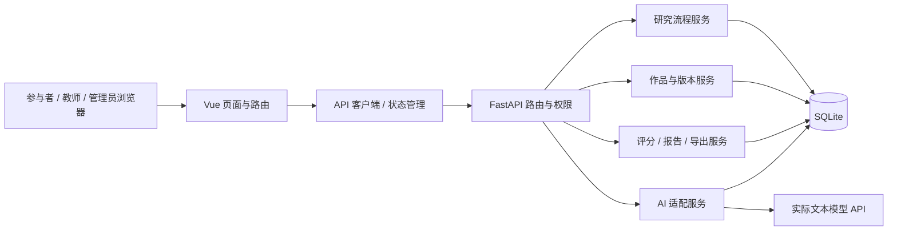

# 项目结构与模块设计

版本：V1.0（2026-11-02）  
状态：目标工程结构；`backend/` 已建立服务基础、首个迁移和任务版本表，其余模块仍待实现<br>
上位需求：[requirements.md](requirements.md)

## 1. 架构决策

系统采用同源部署的前后端分离结构：Vue 前端调用 `/api` 下的 FastAPI 接口，业务状态与时间由后端裁定，SQLite 保存小规模分批研究数据。模型密钥、提示词组装、调用与评分解析全部留在后端。现有 `前端原型-方案2/` 只作为 P04 视觉参考，开发时迁移组件与样式，不直接把演示计时、假保存和预置建议搬进正式系统。

选择 Vue + TypeScript 与 FastAPI + SQLModel 的依据分别见 [Vue 官方 TypeScript 指南](https://vuejs.org/guide/typescript/overview)、[FastAPI 数据库教程](https://fastapi.tiangolo.com/tutorial/sql-databases/)；具体依赖版本在正式建项时锁定并记录。



## 2. 目标目录树

正式工程以 `co-create-eval/` 为根目录。以下是**目标结构**，当前后端实现以 `backend/README.md` 和实际代码为准。

```text
co-create-eval/
├─ README.md                       # 一页式安装、运行、演示与研究模式说明
├─ .env.example                    # 无密钥的环境变量模板
├─ .gitignore                      # 排除数据库、密钥、导出和本地数据
├─ frontend/
│  ├─ package.json
│  ├─ package-lock.json
│  ├─ vite.config.ts
│  ├─ tsconfig.json
│  └─ src/
│     ├─ main.ts
│     ├─ App.vue
│     ├─ router/index.ts           # 三角色路由与守卫
│     ├─ api/client.ts             # 统一请求、错误码、CSRF、重试
│     ├─ api/types.ts              # 与后端响应相符的 DTO
│     ├─ stores/auth.ts            # 当前角色与登录状态
│     ├─ stores/session.ts         # 当前场次、阶段、服务器时间
│     ├─ stores/editor.ts          # 五字段本地草稿与保存状态
│     ├─ components/common/        # 顶栏、状态标签、弹窗、空态
│     ├─ components/creative/      # 任务摘要、章节导航、编辑器、建议区
│     ├─ components/rating/        # 量规、评分输入、匿名作品
│     ├─ components/report/        # 三维分数条、证据、时间线
│     ├─ views/participant/        # P01—P06 与第二场引导
│     ├─ views/teacher/            # P07 队列和评分详情
│     ├─ views/admin/              # P08 配置、进度和导出
│     ├─ styles/tokens.css         # 图片 2 的颜色、字号、间距、状态
│     └─ styles/global.css
├─ backend/
│  ├─ pyproject.toml               # 锁定依赖，Python 兼容范围
│  ├─ app/
│  │  ├─ main.py                    # FastAPI 生命周期、路由注册
│  │  ├─ core/config.py             # 环境配置；不硬编码密钥
│  │  ├─ core/security.py           # 凭证摘要、Cookie、CSRF、权限
│  │  ├─ db/session.py              # 数据库连接与事务
│  │  ├─ db/models/                 # SQLModel 表模型
│  │  ├─ schemas/                   # 请求、响应与枚举；与表模型分开
│  │  ├─ api/auth.py
│  │  ├─ api/participant.py
│  │  ├─ api/creative.py
│  │  ├─ api/ai.py
│  │  ├─ api/teacher.py
│  │  ├─ api/admin.py
│  │  ├─ services/assignment.py     # S1—S4 分配
│  │  ├─ services/stage.py          # 状态机与截止时间
│  │  ├─ services/draft.py          # 保存、修订冲突与快照
│  │  ├─ services/ai/provider.py    # 模型适配器接口及实现
│  │  ├─ services/ai/prompts.py     # 版本化创作/评分提示词
│  │  ├─ services/ai/assessment.py  # 三维结果解析与校验
│  │  ├─ services/rating.py         # 盲评、分歧与均分
│  │  ├─ services/report.py         # 来源分层报告
│  │  ├─ services/export.py         # 匿名数据集与清单
│  │  └─ services/audit.py          # 状态、异常与导出审计
│  ├─ migrations/                  # 数据库结构迁移脚本
│  └─ tests/
│     ├─ conftest.py               # 独立测试数据库与身份夹具
│     ├─ test_access.py
│     ├─ test_stages.py
│     ├─ test_draft.py
│     ├─ test_ai.py
│     ├─ test_rating.py
│     └─ test_export.py
├─ docs/
│  ├─ api-openapi.json              # 由运行中的后端生成
│  ├─ data-dictionary.md            # 与数据库迁移同步
│  ├─ test-records/                 # 试测及验收记录，不含身份信息
│  └─ screenshots/                  # 统一样例截图
├─ scripts/
│  ├─ init_demo.py                  # 演示账号与假数据，禁止研究模式使用
│  ├─ create_batch.py              # 批次/序列初始化
│  ├─ backup_db.py                  # 一致性备份
│  └─ validate_export.py            # 导出重算与完整性检查
└─ data/                           # 本地数据库、备份、导出；不入版本库
```

## 3. 模块职责和调用边界

| 模块 | 输入与输出 | 明确边界 |
| --- | --- | --- |
| `router` / `api` | HTTP 请求与响应 | 只做鉴权、输入校验、调用服务、转换 DTO；不直接写复杂 SQL |
| `assignment` | 批次、研究编号 → 固定 S1—S4 | 只分配一次，保存规则版本；不依据作品表现改分组 |
| `stage` | 当前状态、服务端时间 → 可执行动作/新状态 | 所有阶段迁移只从这里发生；浏览器计时无裁决权 |
| `draft` | 五字段、修订号 → 保存稿/冲突 | 草稿可覆盖，初始/关键/终稿快照不可覆盖 |
| `ai/provider` | 模型请求 → 原始响应/错误 | 不访问教师评分；密钥只在后端；可替换提供方 |
| `ai/assessment` | 锁定终稿、量规 → 已校验三维评分 | 校验失败保留 `failed`；不返回假分数 |
| `rating` | 匿名终稿、教师输入 → 独立原始评分 | 提交前互盲；提交后不可改原始值 |
| `report` | 作品版本、AI 评价、教师评分、事件 → 只读报告 | 只计算派生值，不回写原始评分 |
| `export` | 已授权批次 → 匿名数据与清单 | 不查询明文凭证和身份对应表；记录导出审计 |

服务层可调用数据库仓储，但教师路由必须使用**专门的匿名响应结构**，禁止直接序列化 `study_session` 或 `participant` 表模型。前端也不保存模型密钥、教师完整评分队列或跨参与者缓存。

## 4. 前端路由与状态管理

| 路由 | 页面 | 进入条件 |
| --- | --- | --- |
| `/join` | P01 研究说明 | 未登录参与者 |
| `/participant/task/:sessionId` | P02 任务说明 | 本人会话为待开始 |
| `/participant/idea/:sessionId` | P03 初始构思 | 本人会话为独立构思 |
| `/participant/work/:sessionId` | P04 创作工作台 | 本人会话为完善作品 |
| `/participant/submit/:sessionId` | P05 提交与问卷 | 本人会话已到提交阶段 |
| `/participant/report/:sessionId` | P06 个人报告 | 本人会话已有终稿 |
| `/teacher/queue`、`/teacher/rating/:workId` | P07 教师工作台 | 教师身份且作品已分配 |
| `/admin/*` | P08 管理台 | 管理员身份 |

路由守卫只用于导航体验；真正的访问条件由后端重复验证。前端 `session` store 以服务端返回的 `stage_deadline_at` 计算显示倒计时，重新联网后校正时差。`editor` store 保留未成功提交的本地文本，保存成功后更新修订号；冲突时提示用户比较服务器稿与本地稿，而非覆盖。

## 5. 配置、环境与部署

`.env.example` 至少列出：`APP_MODE`（demo/research）、`DATABASE_URL`、`COOKIE_SECRET`、`FRONTEND_ORIGIN`、`AI_PROVIDER`、`AI_BASE_URL`、`AI_API_KEY`、`AI_CHAT_MODEL`、`AI_ASSESS_MODEL`、`AI_TIMEOUT_SECONDS`、`AI_MAX_TURNS_PER_SESSION`。真实 `.env` 不入库；启动时在研究模式检查模型配置、任务/量规/提示词版本和管理员密码是否齐全，不齐则拒绝开放正式批次。

本地开发：Vite 将 `/api` 代理至 FastAPI；正式试测：前端构建产物与 API 经同一域名提供，Cookie 只在 HTTPS 或受控局域网环境下使用。SQLite 文件、备份和导出放在版本库之外；启动前运行迁移，正式收集期间先备份再升级。演示数据库与研究数据库分开。

## 6. 与现有原型的迁移清单

| 当前 P04 原型 | 正式项目处理 |
| --- | --- |
| 顶栏、五章节导航、编辑画布、蓝灰色与图标 | 提取为组件和设计 token；保持图片 2 风格 |
| 前端倒计时 18:42 | 改为服务器截止时间驱动，可校正与恢复 |
| “已保存”演示状态 | 改为真实请求结果与最后成功保存时间 |
| 刷新即重置的章节内容 | 改为数据库草稿、修订号及本地失败缓冲 |
| 预置 AI 建议 | 改为后端真实模型回复；无密钥时研究模式阻断 |
| 仅当前章节的改写后采纳 | 增加目标章节、来源消息、动作日志和直接采纳 |
| 前端作品预览 | 加入服务端终稿提交、锁定与幂等处理 |

## 7. 建项时的完成条件

目录树并非完成标准。第一步实际编码交付应满足：后端 `/api/health` 与数据库迁移可运行；前端路由启动；演示账号能登录；三种角色接口权限有测试；P04 由真实会话接口返回任务和阶段，而不再显示固定演示内容。
