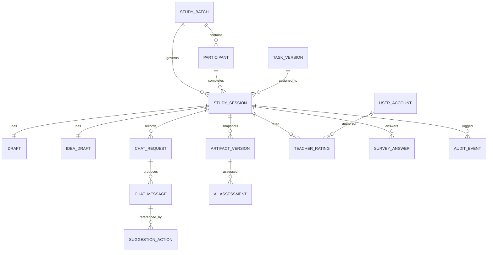

# 数据库设计与数据字典

版本：V1.0（2026-11-02）  
状态：逻辑设计；建表和迁移须与本文件同步  
对应需求：[requirements.md](requirements.md)；对应接口：[api.md](api.md)

## 1. 设计约定

- 第一版使用 SQLite + SQLModel。所有内部主键为 UUID 字符串；外键显式建立，SQLite 连接须启用外键约束。时间统一保存 UTC，前端按 `Asia/Shanghai` 显示。
- `*_version` 表用于固定研究配置。某版本被正式场次引用后不可原地编辑；修订创建新记录。正式批次保存所有所用版本的 ID。
- `study_code` 是研究编号；内部 `participant_id` 不出现在默认导出。评分教师看到随机的 `blind_work_code`，不能凭编号推断参与者或条件。
- 作品与消息原始记录不可覆盖。只有 `draft`、未提交的教师评分草稿及未提交问卷可以更新；更新需要修订号或状态限制。
- 大文本设置输入长度上限；五字段内容以固定键的 JSON 存储，服务端生成纯文本用于 AI 评分和导出。富文本只接受受限标签和链接，展示时再次安全处理。
- 逻辑表中的 `JSON` 在 SQLite 中可存为 `TEXT`，由 Pydantic 校验结构；将来迁移 PostgreSQL 时维持字段语义。

## 2. 公共类型和枚举

| 名称 | 允许值 / 格式 | 说明 |
| --- | --- | --- |
| `condition` | `AI`、`INDEPENDENT` | 独立条件不能出现模型对话记录 |
| `sequence` | `S1`—`S4` | 任务与条件顺序；分配后不可变 |
| `session_state` | `CREATED`、`IDEATION`、`DEVELOPMENT`、`SUBMITTED`、`RATED`、`EXPIRED`、`WITHDRAWN` | 无有效终稿而超时用 `EXPIRED`；`SUBMITTED` 后问卷和 AI 评价由独立状态字段表达 |
| `request_status` | `PENDING`、`SUCCEEDED`、`FAILED`、`TIMEOUT` | 不用空字符串或 0 分代表失败 |
| `assessment_status` | `PENDING`、`SUCCEEDED`、`FAILED` | 一次终稿可有多次尝试，报告列明最终使用的尝试 |
| `rating_status` | `DRAFT`、`SUBMITTED`、`INVALID_REVIEW` | `SUBMITTED` 的原始评分锁定 |
| `action` | `ADOPT`、`EDIT_ADOPT`、`IGNORE` | 显式操作；未表态不补记忽略 |
| `artifact_stage` | `INITIAL`、`DEVELOPMENT`、`FINAL` | 初稿、过程稿、终稿 |
| `mode` | `DEMO`、`RESEARCH` | 正式导出默认仅包含 `RESEARCH` |
| `content_key` | `goal`、`student_task`、`flow`、`resources`、`evaluation` | 作品五字段固定键 |

## 3. 核心表字段

### 3.1 `study_batch`：研究批次

| 字段 | 类型 / 必填 | 规则 |
| --- | --- | --- |
| `id` | UUID / 是 | 主键 |
| `batch_code` | VARCHAR(32) / 是 | 唯一；用于记录批次，不含个人信息 |
| `mode` | ENUM / 是 | `DEMO` 或 `RESEARCH`，创建后不可变 |
| `status` | `DRAFT/PUBLISHED/FROZEN/CLOSED` / 是 | 正式场次开始前冻结配置 |
| `task_a_version_id`、`task_b_version_id` | UUID / 是 | 指向两道题的已发布版本 |
| `rubric_version_id`、`questionnaire_version_id` | UUID / 是 | 明确量规与问卷版本 |
| `chat_prompt_version_id`、`assessment_prompt_version_id` | UUID / 是 | 两种提示词分别记录 |
| `model_config_version_id` | UUID / 是 | 记录模型标识和参数，不存密钥 |
| `assignment_rule_version` | VARCHAR(20) / 是 | 四序列分配规则版本 |
| `created_at`、`frozen_at` | UTC 时间 / 部分可空 | 状态变化时间 |

### 3.2 `participant`：匿名参与者

| 字段 | 类型 / 必填 | 规则 |
| --- | --- | --- |
| `id` | UUID / 是 | 内部主键 |
| `batch_id` | UUID / 是 | 外键；同批次分配 |
| `study_code` | VARCHAR(32) / 是 | 全局唯一；研究导出的关联键 |
| `credential_hash` | VARCHAR(255) / 是 | 只存安全摘要，不存明文凭证 |
| `sequence` | ENUM / 是 | `S1`—`S4`，分配后冻结 |
| `consent_version`、`consented_at` | 字符串/UTC 时间 / 可空 | 未同意不得开始场次 |
| `withdrawn_at`、`withdrawal_reason_code` | 时间/枚举 / 可空 | 退出研究后的排除和审计 |
| `created_at` | UTC 时间 / 是 | 创建时间 |

`participant` 不保存姓名、手机号或学号。如学校流程必须有身份对应表，应在独立受保护位置管理，不从本库默认导出。

### 3.3 `user_account` 与 `auth_session`：教师和管理员账户

| 表 | 关键字段 | 规则 |
| --- | --- | --- |
| `user_account` | `id`、`username`、`password_hash`、`role`、`active`、`created_at` | `role=TEACHER/ADMIN`；用户名唯一；无明文密码 |
| `auth_session` | `id`、`principal_type`、`principal_id`、`token_hash`、`csrf_hash`、`expires_at`、`revoked_at` | 浏览器 Cookie 仅保存随机会话令牌；数据库保存摘要；退出时撤销 |

教师账号不与参与者账号复用。为评分教师分配作品应使用额外的 `rating_assignment(id, session_id, rater_id, blind_work_code, assigned_at)`；唯一约束为 `(session_id, rater_id)`，同一作品至少分配给两名不同教师。`blind_work_code` 在评分队列中稳定但随机，与 `study_code` 无可见映射。

### 3.4 配置版本表

| 表 | 关键字段 | 不可变规则 |
| --- | --- | --- |
| `task_version` | `id`、`task_code`（A/B）、`version`、`title`、`scenario`、`instructions`、`constraints_json`、`ideation_seconds`、`development_seconds`、`published_at` | `(task_code, version)` 唯一；发布且被引用后不改正文 |
| `rubric_version` | `id`、`version`、`dimensions_json`、`anchors_json`、`published_at` | 固定三维和 1—5 分锚点；版本唯一 |
| `questionnaire_version` | `id`、`version`、`items_json`、`published_at` | 题项带共同/AI 专属标识；版本唯一 |
| `prompt_version` | `id`、`kind`（CHAT/ASSESSMENT）、`version`、`template`、`published_at` | `(kind, version)` 唯一；不存密钥 |
| `model_config_version` | `id`、`version`、`provider_name`、`chat_model_id`、`assess_model_id`、`temperature`、`max_output_tokens`、`timeout_seconds` | 记录可复现实验参数；API key 从环境读取，不进表 |

### 3.5 `study_session`：一场任务

| 字段 | 类型 / 必填 | 规则 |
| --- | --- | --- |
| `id` | UUID / 是 | 主键 |
| `participant_id`、`batch_id`、`task_version_id` | UUID / 是 | 外键且批次一致 |
| `round_no` | INTEGER / 是 | 仅 1 或 2；`(participant_id, round_no)` 唯一 |
| `condition` | ENUM / 是 | 与分配序列一致，不可改 |
| `state` | ENUM / 是 | 仅通过状态服务迁移 |
| `blind_work_code` | VARCHAR(32) / 是 | 随机唯一；教师视图只返回此码 |
| `ideation_started_at`、`ideation_deadline_at` | UTC 时间 / 可空 | 服务器裁定 5 分钟 |
| `development_started_at`、`development_deadline_at` | UTC 时间 / 可空 | 服务器裁定 20 分钟 |
| `submitted_at`、`final_version_id` | UTC 时间/UUID / 可空 | 终稿提交后固定；`final_version_id` 指向本场 FINAL |
| `survey_status`、`exclusion_status` | 枚举 / 是 | 与主状态分开；退出/无效可标记 |

约束：每人最多两场；两场的任务与条件互补；同一场最多一份 FINAL。受 SQLite 跨表约束能力限制的规则由事务中的服务层检查，并用集成测试覆盖。

### 3.6 `idea_draft`、`draft` 与 `artifact_version`：编辑和快照

| 表 | 字段 | 规则 |
| --- | --- | --- |
| `idea_draft` | `session_id`、`idea_json`、`revision_no`、`saved_at` | `session_id` 唯一；三个构思字段；仅 IDEATION 可更新；按修订号防冲突 |
| `draft` | `session_id`、`sections_json`、`revision_no`、`saved_at`、`last_editor_client_id` | `session_id` 唯一；修订号从 0 递增；`WHERE revision_no = expected` 成功才更新 |
| `artifact_version` | `id`、`session_id`、`stage`、`revision_no`、`content_json`、`plain_text`、`source_event_id`、`created_at` | 只追加；`INITIAL` 与 `FINAL` 各至多一份；过程稿可多份 |

`INITIAL` 的 `content_json` 使用 `idea_problem`、`idea_activity`、`idea_evidence` 三键；`DEVELOPMENT/FINAL` 使用五个 `content_key`。`plain_text` 由服务端从内容生成，供评分和导出。保存正式终稿时在同一事务写入 FINAL 版本、更新会话状态和审计事件。

### 3.7 AI 对话与建议动作

| 表 | 字段 | 规则 |
| --- | --- | --- |
| `chat_request` | `id`、`session_id`、`client_request_id`、`status`、`model_config_version_id`、`prompt_version_id`、`started_at`、`finished_at`、`duration_ms`、`error_code` | `(session_id, client_request_id)` 唯一；失败也保留 |
| `chat_message` | `id`、`request_id`、`session_id`、`role`（USER/ASSISTANT）、`content`、`created_at` | 每次请求至少保存 USER；成功后保存 ASSISTANT；独立场不得插入 |
| `suggestion_action` | `id`、`session_id`、`assistant_message_id`、`action`、`target_section`、`selected_text`、`inserted_text`、`created_at` | 只引用本场 ASSISTANT 消息；`IGNORE` 不含插入文本；记录插入后的草稿修订号 |

用户手动复制模型内容时系统可能无法识别，不从文本相似度自动补记动作。原始回复只在有权限的协作/管理员视图展示，教师视图永不关联该表。

### 3.8 `ai_assessment`：辅助评价尝试

| 字段 | 类型 / 必填 | 规则 |
| --- | --- | --- |
| `id`、`session_id`、`final_version_id` | UUID / 是 | 只允许对应已锁定终稿 |
| `attempt_no`、`client_request_id` | INTEGER/UUID / 是 | 同一终稿重试有新尝试号；请求号幂等 |
| `status` | ENUM / 是 | `PENDING/SUCCEEDED/FAILED` |
| `rubric_version_id`、`prompt_version_id`、`model_config_version_id` | UUID / 是 | 每次尝试固定版本 |
| `raw_response`、`parsed_json` | TEXT/JSON / 可空 | 失败保留原始输出；校验成功后才填 `parsed_json` |
| `error_code`、`started_at`、`finished_at` | 枚举/时间 / 部分可空 | 不用 0 分表示失败 |

`parsed_json` 须有三个维度，各含整数 `score∈[1,5]`、来自终稿的 `evidence`、`reason`；另有 `suggestion`。报告选择被明确标记的最新有效尝试；原始失败尝试不删除。

### 3.9 `teacher_rating`、`survey_answer`、`audit_event`

| 表 | 字段 | 规则 |
| --- | --- | --- |
| `teacher_rating` | `id`、`session_id`、`rater_id`、`final_version_id`、`rubric_version_id`、`novelty`、`fit`、`feasibility`、`strength`、`improvement`、`status`、`submitted_at`、`updated_at` | `(session_id,rater_id)` 唯一；草稿可更新；正式提交各分 1—5 且评语非空；提交后锁定 |
| `survey_answer` | `id`、`session_id`、`questionnaire_version_id`、`item_code`、`value`、`submitted_at` | `(session_id,item_code)` 唯一；值为 1—5；非该条件题项不得提交 |
| `audit_event` | `id`、`session_id`、`actor_type`、`actor_id`、`event_type`、`payload_json`、`server_time` | 只追加；记录状态迁移、冲突、失败、人工更正、导出 |

若作品被判无效，`teacher_rating.status=INVALID_REVIEW` 并存原因，不强制三个分数。两名教师意见不一致时，复核结果另建 `rating_review`，不得覆写二人的原始分数。

## 4. 索引、事务和删除规则

| 对象 | 必需索引或事务 |
| --- | --- |
| 身份与分组 | `participant.study_code` 唯一；`user_account.username` 唯一；`participant(batch_id, sequence)` 普通索引 |
| 场次 | `study_session(participant_id, round_no)` 唯一；`blind_work_code` 唯一；`(batch_id,state)` 便于管理进度 |
| 草稿 | `idea_draft.session_id` 和 `draft.session_id` 分别唯一；保存以 `revision_no` 乐观锁更新 |
| 版本 | `(session_id, stage, created_at)`；INITIAL/FINAL 唯一约束或事务检查 |
| 对话 | `(session_id, client_request_id)` 唯一；`chat_message(session_id, created_at)` |
| 教师 | `rating_assignment(session_id,rater_id)` 唯一；`teacher_rating(session_id,rater_id)` 唯一 |
| 问卷 | `survey_answer(session_id,item_code)` 唯一 |

跨多表操作在一次数据库事务中完成：开始阶段、提交初稿、提交终稿、教师正式评分、管理员冻结批次。正式研究库不使用级联删除清除原始记录；退出研究按学校要求执行受控删除或标记排除，并在审计中记录处理方式。备份与导出文件需按批次和时间命名，防止覆盖。

## 5. 匿名导出数据集

默认生成 ZIP，内含 UTF-8 CSV 和 `manifest.json`：

| 文件 | 最少字段 | 可复核用途 |
| --- | --- | --- |
| `sessions.csv` | `study_code`、`round_no`、`task_code/version`、`condition`、`sequence`、`state`、时间、排除状态 | 四序列与完成率 |
| `artifacts.csv` | `study_code`、场次、阶段、版本号、五字段或初始构思、时间 | 初稿/过程稿/终稿 |
| `chat.csv` | `study_code`、场次、请求号、角色、内容、模型/提示词版本、状态、时间 | 对话与失败率 |
| `actions.csv` | `study_code`、场次、消息请求号、动作、目标字段、插入文字、时间 | 显式建议处理 |
| `ai_assessments.csv` | `study_code`、场次、三维分数/证据/理由、状态、模型/量规版本 | AI 与教师比较 |
| `teacher_ratings.csv` | `study_code`、场次、匿名教师代码、三维原始分、评语、状态、时间 | 双教师一致性与均分重算 |
| `survey_answers.csv` | `study_code`、场次、问卷版本、题号、原始值 | 体验分析 |
| `manifest.json` | 批次、导出时间、字段版本、记录数、配置版本、文件校验值 | 来源与完整性 |

默认不导出 `credential_hash`、Cookie、CSRF、模型密钥、真实姓名、手机号、内部管理备注。管理员导出前看到匿名化预览和记录数量；导出事件写入审计。`study_code` 是匿名研究编号，但仍应按研究数据保护，不公开随意传播。

## 6. 迁移和校验

首次建项生成迁移 `001_initial_schema`。每次新增字段或改变约束都生成新迁移，不在正式库直接手工改表。测试数据库按迁移创建，避免与正式结构分叉。正式收集前运行：外键检查、唯一约束检查、每人两场互补检查、独立场 AI 记录为零检查、终稿与评分关联检查、导出记录数与数据库记录数核对。
